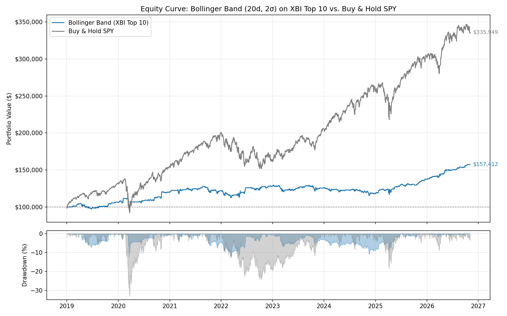
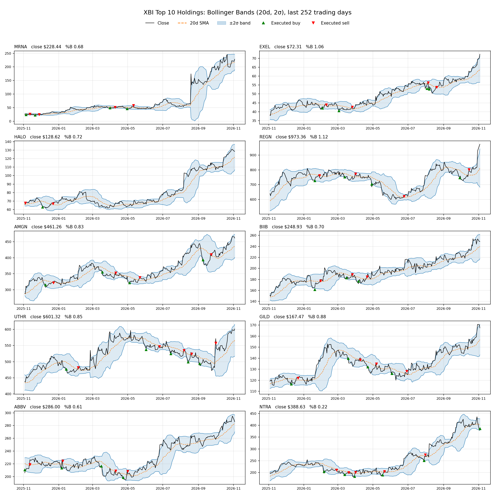
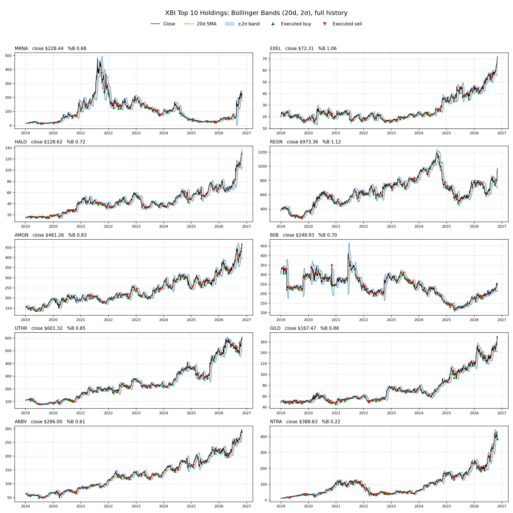

# MSDS 451 – Assignment 03: Bollinger Band Auto-Trading

`Assignment03.py` backtests a Bollinger Band mean-reversion strategy on the top 10 holdings of the XBI biotech ETF and compares it with buy-and-hold SPY. It uses [yfinance](https://github.com/ranaroussi/yfinance) for market data and [Backtrader](https://www.backtrader.com/) for the backtest.

## What the script does

1. **Ingests data.** It downloads daily, split- and dividend-adjusted OHLCV prices from Yahoo Finance for:
   - XBI top 10 holdings: `MRNA, EXEL, HALO, REGN, AMGN, BIIB, UTHR, GILD, ABBV, NTRA`
   - Benchmark: `SPY`
2. **Computes Bollinger Bands.** Each band uses a 20-day rolling mean ± 2 standard deviations.
3. **Backtests with Backtrader.** The strategy is long-only and trades each stock independently:
   - **Buy** when the close crosses *below* the lower band. Each position is sized to about 1/10 of portfolio equity.
   - **Sell** the whole position when the close crosses back *above* the 20-day average (middle band).
   - SPY isn't traded. It's held as a buy-and-hold benchmark.

## Requirements

- Python 3.10 or newer (tested on 3.13)
- An internet connection, because data is downloaded on each run

Install the dependencies:

```bash
pip install -r requirements.txt
```

`requirements.txt` sets minimum versions. These versions were tested: yfinance 1.7.0, backtrader 1.9.78.123, pandas 2.2.3, matplotlib 3.10.0.

## How to run

From the repository root:

```bash
python Assignment03.py
```

A run takes under a minute. Progress and results print to the terminal:

- Rows downloaded and the date range for each ticker
- Latest Bollinger Band levels and %B for each ticker
- Performance summary (strategy vs. SPY): ending value, total return, CAGR, Sharpe, max drawdown, trade count and win rate
- Closed-trade P&L by ticker

## Outputs

The script creates two folders next to itself:

| Path | Contents |
|---|---|
| `data/<TICKER>.csv` | Raw downloaded daily prices (git-ignored; re-created on each run) |
| `output/<TICKER>_bollinger.csv` | Prices with band values (`BB_Mid`, `BB_Upper`, `BB_Lower`, `BB_PctB`) and raw buy/exit crossing signals |
| `output/<TICKER>_bands.png` | One-year bands chart for each ticker, marking every raw band crossing |
| `output/xbi_top10_bands_grid.png` | All 10 stocks in one 5×2 grid, last 252 trading days, with executed buys and sells |
| `output/xbi_top10_bands_grid_full.png` | The same grid over the full backtest period |
| `output/equity_curve.png` | Strategy equity vs. buy-and-hold SPY, with a drawdown panel |
| `output/performance_summary.csv` | Summary metrics for both strategies |
| `output/trades_by_ticker.csv` | Closed-trade count, net P&L, win rate and average holding period for each ticker |
| `output/trade_log.csv` | Every executed order (date, ticker, side, size, price, commission) |

Each run overwrites these files.

## Results

These charts come from the run committed to this repo (2019-01-02 to 2026-11-03). They'll change if you re-run the script with a later end date.

| | Bollinger Band (XBI Top 10) | Buy & Hold SPY |
|---|---|---|
| Ending value (from $100k) | $157,412 | $335,949 |
| CAGR | 5.97% | 16.76% |
| Sharpe ratio | 0.66 | 0.91 |
| Max drawdown | 12.5% | 33.3% |
| Closed trades / win rate | 335 / 68% | n/a |

### Equity curve vs. buy-and-hold SPY



### Bollinger Bands for all 10 stocks (last 252 trading days)

Green triangles mark the strategy's executed buys and red triangles its executed sells.



### Bollinger Bands for all 10 stocks (full period)



## Configuration

Edit the constants near the top of `Assignment03.py`:

| Setting | Default | Meaning |
|---|---|---|
| `XBI_TOP10` | the 10 tickers above | Stocks the strategy trades |
| `BENCHMARK` | `"SPY"` | Buy-and-hold comparison |
| `START_DATE` | `"2019-01-01"` | Backtest start. MRNA began trading in Dec 2018, so this gives every stock the same history. |
| `END_DATE` | today | Backtest end |
| `BB_PERIOD` | `20` | Rolling lookback in trading days |
| `BB_DEVFACTOR` | `2.0` | Standard deviation multiplier |
| `EXIT_BAND` | `"mid"` | Exit at the middle band (`"mid"`) or hold until the upper band (`"upper"`) |
| `STARTING_CASH` | `100_000` | Starting capital for each strategy |
| `COMMISSION` | `0.001` | Commission per trade (0.1%) |

To print every buy and sell as the backtest runs, change `printlog=False` to `printlog=True` in the `build_cerebro(BollingerBandStrategy, ...)` call in `main()`.

## Notes and limitations

- Orders are placed at a day's close and fill at the next day's open, which is Backtrader's default.
- Positions are sized from current equity, so gains compound. Idle cash earns no interest, though, which explains much of the gap with SPY.
- Yahoo Finance data can occasionally contain errors or gaps. Check unusual price jumps before drawing conclusions.
- This is an academic exercise, not investment advice.
